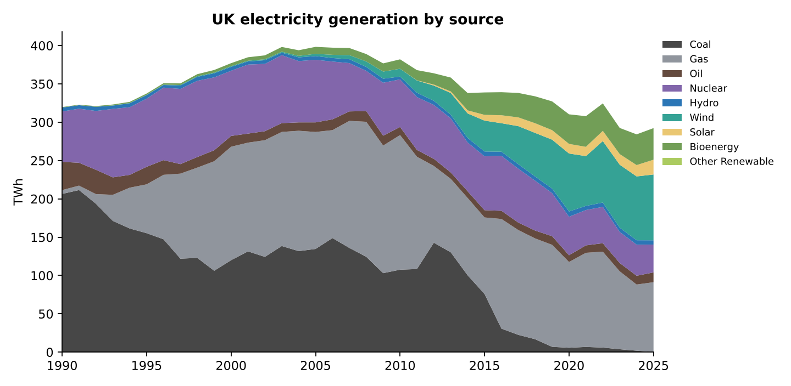
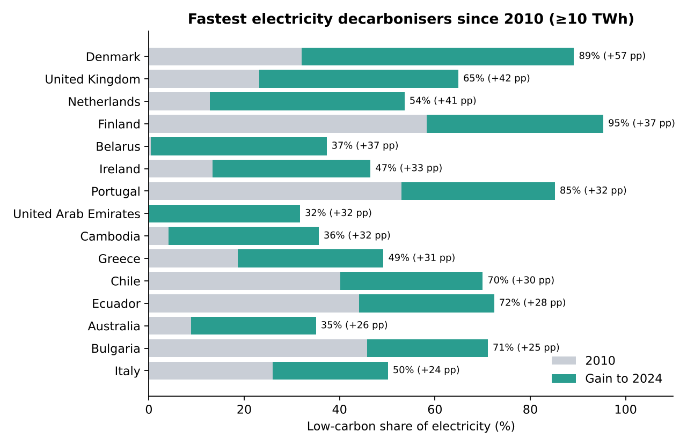
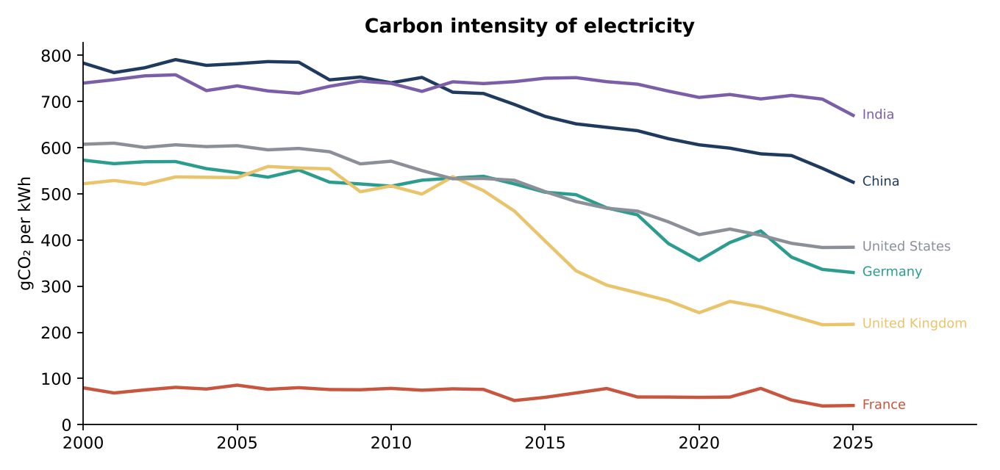

# GridFlow — a tested, scheduled ELT pipeline for global energy data

[](https://github.com/blue-wiz/gridflow/actions/workflows/pipeline.yml)

GridFlow loads the **Our World in Data** energy and CO₂ datasets every week. OWID compiles them from sources including the Energy Institute, Ember and the Global Carbon Project. It models them with **dbt** in PostgreSQL, tests every layer and publishes analysis-ready tables. One command runs it locally; GitHub Actions runs it on a schedule.



## What it found

- **The UK has decarbonised its electricity faster than almost any large country.** Its low-carbon share rose from 23% in 2010 to 65% in 2024 (+42 percentage points). That ranks **2nd of 108 countries** generating at least 10 TWh, behind only Denmark (+57 pp).
- **UK coal has all but gone.** Coal produced 65% of UK electricity in 1990 and 0.3 TWh in 2025. Carbon intensity fell from 517 to 217 gCO₂/kWh between 2010 and 2025.
- **Large emitters are moving at very different speeds.** China's grid intensity is falling steadily, India's barely. France's nuclear-heavy grid has stayed below 100 g/kWh since 2000.




## Architecture

```
 OWID energy CSV ─┐                       ┌─ stg_owid_energy ─┐            ┌─ dim_country
                  ├─► raw (JSONB rows) ───┤                    ├─► marts ──┼─ fct_country_year
 OWID CO₂ CSV ────┘   + raw.load_log       └─ stg_owid_co2 ────┘            ├─ mart_electricity_mix
   extract_load.py    (sha256, rows,         dbt views                      └─ mart_decarbonisation
                       loaded_at)            (typed, countries only)          dbt tables
        ▲                                                                        │
        └──────────── GitHub Actions: every Monday 06:17 UTC ── 26 dbt tests ───┴─► report.py → charts
```

| Layer | Rows (Oct 2026 load) |
|---|---|
| raw.owid_energy | 23,377 rows × 130 columns |
| raw.owid_co2 | 50,411 rows × 79 columns |
| marts.fct_country_year (1990+) | 7,696 |
| marts.dim_country | 220 |
| marts.mart_electricity_mix | 52,339 |
| marts.mart_decarbonisation | 108 ranked countries |

## Engineering decisions

- **Idempotent loads.** Each file's SHA-256 is stored in `raw.load_log`. Re-running the pipeline on an unchanged file does nothing, which makes the job safe to retry after a failure.
- **History is kept.** A new version of a file is appended with a new `load_id` rather than overwriting the old one. Staging reads only the latest load, so any earlier version can be rebuilt.
- **Schema-drift safe.** Raw rows are stored as JSONB, so a new column published by OWID cannot break the load. dbt selects only the columns the models need.
- **Tests at every layer:**
  - 26 dbt tests: uniqueness, not-null, value ranges (shares between 0 and 100, carbon intensity between 0 and 1500), relationships and accepted values
  - a reconciliation test checking that sources add up to total generation within 2%
  - a canary test that fails if UK data disappears or goes stale
  - source freshness, which warns after 14 days without a new file
  - 4 pytest tests for the loader: idempotency, history, nulls and validation
- **The tests caught a bug during the build.** A relationship test failed because 34 country-years belonged to territories with energy data but no population series. `dim_country` was fixed to include them.

## Why each tool

| Tool | Why |
|---|---|
| **Python** (extract/load) | Simple, explicit control of download, hashing, retries and bulk insert (`execute_values`). There is no heavy framework to learn for two sources. |
| **PostgreSQL** | A production-grade warehouse that runs anywhere (locally, in Docker or as a CI service). JSONB makes the raw layer flexible. |
| **dbt** | The industry standard for the "T" in ELT. It provides SQL models with dependencies (`ref`), tests next to the models, source freshness and auto-generated lineage docs (`make docs`). |
| **Jinja macros** | The electricity mix is unpivoted with a loop rather than nine copy-pasted queries. Custom generic tests (`accepted_range`, `unique_combination`) avoid needing extra packages. |
| **GitHub Actions** | Free scheduling and CI. Every push and every Monday runs the tests, the load, dbt and the report, then uploads the charts as an artifact. |
| **Docker Compose** | One command (`docker compose up -d`) gives anyone the same database. |
| **pytest** | Tests the loader's guarantees against a live PostgreSQL database, not mocks. |

## Run it

```bash
docker compose up -d                       # PostgreSQL 16 on localhost:5432
docker compose exec postgres psql -U postgres -c "CREATE DATABASE gridflow_test;"
python -m venv .venv && source .venv/bin/activate
pip install -r requirements.txt
make all                                   # extract → dbt build (+tests) → report
make test                                  # pytest
make docs                                  # dbt lineage graph in the browser
```

To schedule it, push the repo to GitHub. The workflow in `.github/workflows/pipeline.yml` runs automatically, and you can also trigger it from the **Actions** tab with "Run workflow".

## Data

Our World in Data, [energy-data](https://github.com/owid/energy-data) and [co2-data](https://github.com/owid/co2-data), licensed CC BY 4.0. OWID compiles these from the Energy Institute *Statistical Review of World Energy*, Ember, the EIA and the Global Carbon Project. The latest year in each file can be incomplete for some countries. The decarbonisation ranking therefore uses the latest year with carbon-intensity data for at least 150 countries (2024 in this load).
